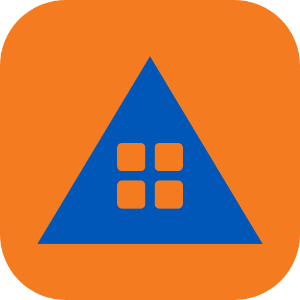

<h1 align="center">zivilschutz.app</h1>

Krokis und Lagepläne zeichnen. Informationen verbinden. Gemeinsam handeln.

<a href="https://zivilschutz.app/download"><b>App herunterladen</b></a> · <a href="https://zivilschutz.app">zivilschutz.app</a>

Dieses Repository enthält nur die veröffentlichten Installer und die Update-Informationen der App. Der Quellcode ist nicht öffentlich.

Die App braucht beim ersten Start eine Aktivierung. Kontakt: kontakt@zivilschutz.app
